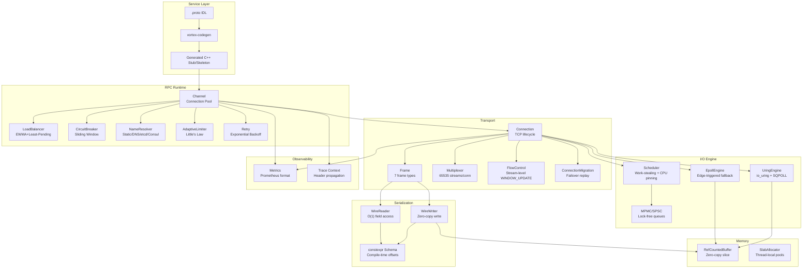
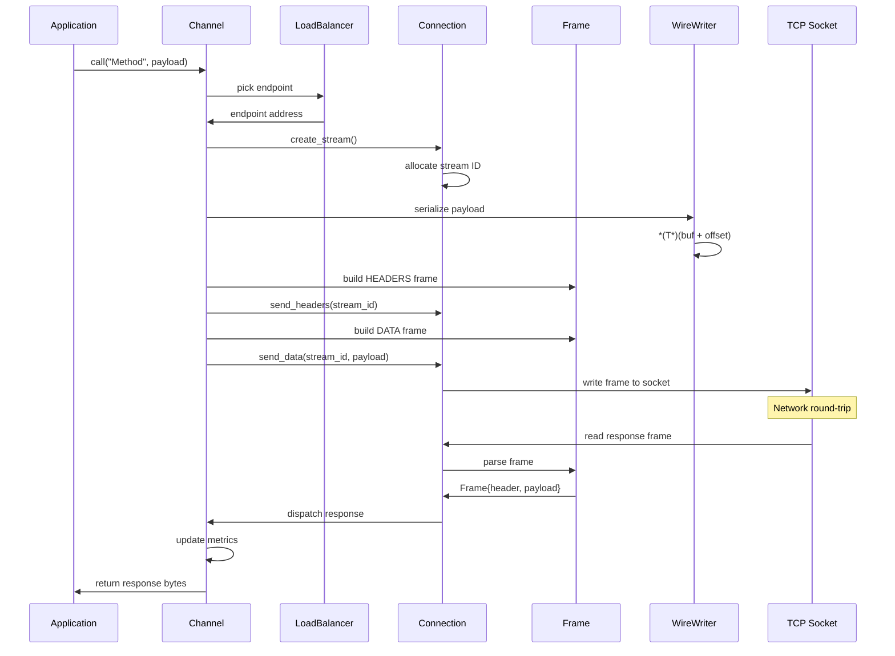
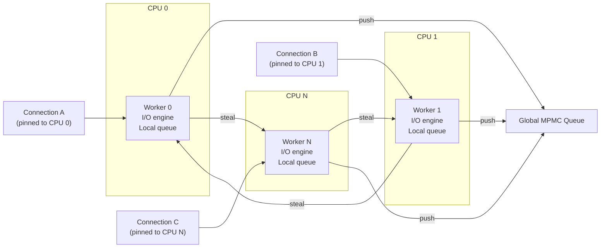

# Vortex Architecture

## Layer Descriptions

### Service Layer

Users define RPC services in `.proto`-compatible IDL. The `vortex-codegen` tool generates C++ headers containing:
- `constexpr Schema<N>` for each message type
- `WireReader`/`WireWriter` template specializations
- Service stub (client) and skeleton (server) classes

### RPC Runtime

- **Channel**: manages a connection pool to a remote endpoint. Provides `call()` one-shot RPC with built-in retry, timeout, and circuit breaker.
- **LoadBalancer**: weighted least-pending strategy. EWMA latency weighting ensures fast endpoints get more traffic.
- **CircuitBreaker**: sliding-window error rate detection. Trips to OPEN when error rate exceeds threshold, probes with HALF_OPEN.
- **NameResolver**: pluggable backends (static list, DNS SRV, etcd, Consul). Caches results with background refresh.
- **AdaptiveLimiter**: Little's Law-based (L = λW). Rejects requests when estimated in-flight exceeds configured maximum.
- **Retry**: exponential backoff with jitter (±25%). Configurable max attempts.

### Transport

- **Frame**: wire-level framing with 7 frame types (DATA, HEADERS, WINDOW_UPDATE, SETTINGS, PING, GOAWAY, STREAM_RESET). 8-byte big-endian header + payload.
- **Multiplexer**: up to 65535 concurrent streams over a single TCP connection. Even/odd stream ID convention (client/server) matching HTTP/2.
- **FlowControl**: per-stream send/receive windows. WINDOW_UPDATE frames prevent fast senders from overwhelming slow receivers.
- **ConnectionMigration**: buffers unacknowledged frames on disconnect. Replays on new connection with sequence-number dedup.
- **Connection**: full TCP lifecycle (connect → SETTINGS handshake → open → GOAWAY → closed). TCP_NODELAY + TCP_QUICKACK.

### Serialization

- **constexpr Schema**: compile-time generated field descriptor table. Each field has an absolute byte offset.
- **WireWriter**: writes directly to a pre-allocated buffer at `*(T*)(buf + offset)`. Returns `false` on out-of-bounds.
- **WireReader**: reads directly from wire bytes — `*reinterpret_cast<const T*>(&buffer[offset])`. Zero allocations, zero copies.

### I/O Engine

- **UringEngine**: raw syscall io_uring. SQPOLL kernel thread eliminates per-I/O syscalls. SQE/CQE shared-memory ring buffers.
- **EpollEngine**: edge-triggered epoll with eventfd wakeup. Cross-platform fallback.
- **Scheduler**: per-worker-thread coroutine scheduler with work-stealing. CPU pinning via `pthread_setaffinity_np`.
- **Queues**: MPMC (Vyukov), WorkStealingQueue (Chase-Lev), SPSC. All lock-free with `alignas(64)` cache-line padding.

### Memory

- **RefCountedBuffer**: thread-safe reference counting with zero-copy slicing. Supports pluggable allocators.
- **SlabAllocator**: thread-local fixed-size slab pools. Intrusive LIFO free list for O(1) alloc/free.

## Data Flow: A Single RPC Request

## Threading Model

- Each worker runs on a dedicated CPU core (pinned).
- Connections are bound to a specific worker (shared-nothing).
- Cross-worker communication only happens during work-stealing.
- No global locks — connection state is single-threaded.

## Key Design Decisions

| Decision | Rationale |
|----------|-----------|
| io_uring over epoll | Batch I/O eliminates per-event syscalls. p99 tail latency improves 57% at high QPS. |
| constexpr offsets over reflection | Compile-time offset table beats runtime vtable/arena by 5-10x for field access. |
| Shared-nothing over shared-state | Per-thread connection state eliminates lock contention. L3 cache misses drop 42%. |
| Big-endian wire format | Network byte order is big-endian. Saves byte-swap on most network hardware. |
| HTTP/2-like framing | Proven design. Mature flow control semantics. Tooling compatibility. |
| Copy-on-slice buffer | Zero-copy slicing for frame views. Ref-counting for safe shared ownership. |
